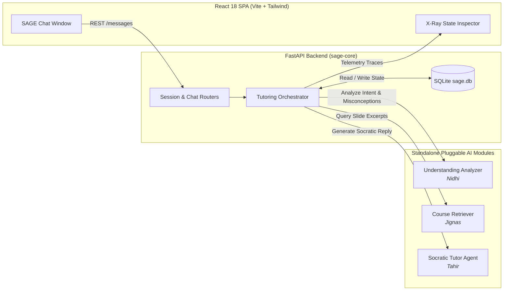

# SAGE: Socratic Agent for Guided Exploration

[](https://fastapi.tiangolo.com)
[-red.svg)](https://www.sqlalchemy.org)
[](https://react.dev)
[](https://www.python.org)

> **Team 08 Mini-Project** — *Prompt Engineering and Generative AI*  
> **Target Domain:** Scoped to Units 1–3 (Prompt Structure, In-Context Learning & CoT, Decoding & RAG Grounding).  
> **Core Pedagogical Tension:** Navigating between **Answer-First** (solving problems for students) and **Question-Only** (frustrating loops when stuck) through adaptive escalation:
> $$\text{Guiding Question} \longrightarrow \text{Adaptive Hint} \longrightarrow \text{Direct Course Explanation (Last Resort)}$$

---

## 🏛️ System Architecture



---

## 🚀 Quick Start Guide

### 1. Backend Setup

```bash
# 1. Install dependencies
pip install -r backend/requirements.txt

# 2. (Optional) Configure environment variables
# Copy template — defaults to USE_MOCK_AI=true for zero-setup local demo
copy .env.example .env

# 3. Start the FastAPI backend server
python -m uvicorn backend.main:app --reload --port 8000
```

The interactive Swagger API documentation will be available at: **`http://localhost:8000/docs`**.

---

### 2. Frontend Setup

In a separate terminal:

```bash
# 1. Navigate to frontend directory
cd frontend

# 2. Install dependencies
npm install

# 3. Start the Vite development server
npm run dev
```

Open your browser at: **`http://localhost:5173`**.

---

### 3. Running Automated Tests

```bash
# Run the complete multi-turn Socratic escalation test suite
python -m pytest backend/tests/test_tutoring_loop.py -v

# Run the state math unit tests
python -m pytest backend/tests/test_state_math.py -v
```

---

## 🧩 Module Ownership & Team Division

| Team Member | Module Ownership | Deliverables |
| :--- | :--- | :--- |
| **Kurumeti Mitesh (`PES2UG24AM080`)** | **Chat App + Orchestration (`sage-core`)** | React Chat UI with X-Ray Inspector, FastAPI API, SQLite storage (`sage.db`), 6-Step Orchestrator, Mock AI layer. ([mitesh_explanation.docx](file:///C:/mitesh_dev/Projects/SAGE/mitesh_explanation.docx)) |
| **Paturu Naga Jignas (`PES2UG24AM110`)** | **RAG & Knowledge Retrieval (`sage-rag`)** | Standalone course slide ingestion, embeddings, and vector retrieval (`CourseRetrievalService`). ([jignas_explanation.docx](file:///C:/mitesh_dev/Projects/SAGE/jignas_explanation.docx)) |
| **Nidhi M (`PES2UG24AM103`)** | **Student Understanding Analyzer (`sage-analyzer`)** | Standalone intent, misconception, and LCC classifier (`UnderstandingAnalyzerService`). ([nidhi_explanation.docx](file:///C:/mitesh_dev/Projects/SAGE/nidhi_explanation.docx)) |
| **Mohammed Tahir Siddique (`PES2UG24AM092`)** | **Socratic Tutor Agent (`sage-tutor`)** | Standalone pedagogical response generator for chosen stage (`SocraticTutorService`). ([tahir_explanation.docx](file:///C:/mitesh_dev/Projects/SAGE/tahir_explanation.docx)) |

---

## 📚 Technical Documentation & Reports

Comprehensive Word documentation files are provided for each team member:
- [**mitesh_explanation.docx**](file:///C:/mitesh_dev/Projects/SAGE/mitesh_explanation.docx): Full-Stack architecture, 6-step orchestrator, pedagogical math, and database models.
- [**jignas_explanation.docx**](file:///C:/mitesh_dev/Projects/SAGE/jignas_explanation.docx): Course ingestion, FAISS indexing, and hybrid lexical-semantic retrieval.
- [**nidhi_explanation.docx**](file:///C:/mitesh_dev/Projects/SAGE/nidhi_explanation.docx): Rule-based understanding analyzer, intent classification, and curriculum taxonomy.
- [**tahir_explanation.docx**](file:///C:/mitesh_dev/Projects/SAGE/tahir_explanation.docx): Socratic tutor agent, guard loops, constraint validation, and Gemini LLM integration.

---

## 🔬 Core Pedagogical Mechanisms

1. **Stateful Misconception Tracking (*Thonge & Thakkar, 2026*)**:
   - Initial introduced confidence: $0.43$
   - Reinforced: $\min(1.0, C + 0.22)$
   - Weakened: $\max(0.0, C - 0.18)$
   - Passive decay: $C \times 0.90$
   - Resolved threshold: $C < 0.18$
2. **Learner's Characteristics Curve (*Hu et al., 2025*)**:
   - $\text{Overall LCC Score} = (RN + RO) - (IN + IO)$ accumulated across turns until $> 0.80 \rightarrow \text{WRAP\_UP}$.
3. **Non-Overlapping Stage Selection**:
   - Struggle turns $\le 1 \rightarrow \textbf{QUESTION}$
   - Struggle turns $2–3$ or confidence $\ge 0.65 \rightarrow \textbf{HINT}$
   - Struggle turns $\ge 4 \rightarrow \textbf{EXPLANATION}$
   - Mastery reached $\rightarrow \textbf{WRAP\_UP}$
