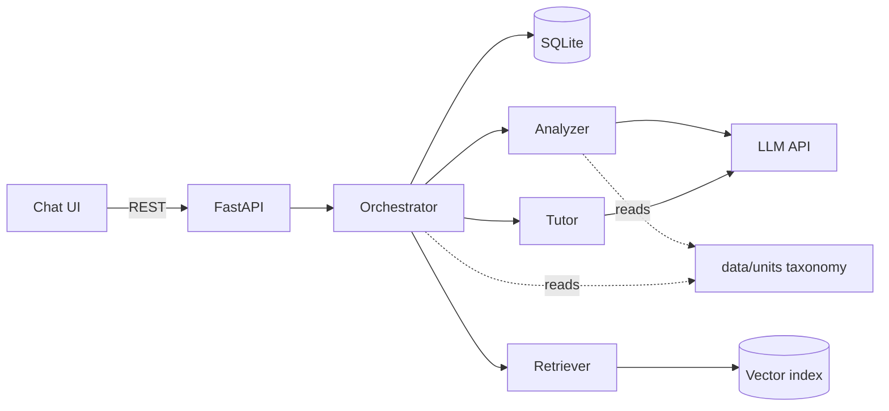

# Architecture — SAGE

## Stack
- **Frontend:** React + Vite + TypeScript + Tailwind CSS
- **Backend:** Python, FastAPI
- **Database:** SQLite (`sage.db`) via SQLAlchemy 2.0
- **Retrieval:** a local vector index (ChromaDB or FAISS) plus an embedding model. Jignas owns this choice.
- **LLM:** one shared provider for the analyzer and tutor, set in `.env` (`LLM_PROVIDER`, `LLM_MODEL`, `LLM_API_KEY`). The provider is not picked yet.
- **Hosting:** local only (laptop demo)

## System flow

The frontend does **no** pedagogical reasoning. All analysis, state math, retrieval and move selection happen in the backend.

## Turn loop & stage rules
For each student message, the orchestrator runs these steps:

1. Save the message and load the session's `LearnerState`.
2. **Analyze** the message. `analyze()` returns intent, classification, topic, misconception verdicts and LCC scores.
3. **Update state** (orchestrator only):
   - **Misconception confidence:** a misconception enters `active_misconceptions` at **0.43** when it is first `introduced`.
     - `reinforced`: +0.22, capped at 1.0
     - `weakened`: −0.18, with a floor of 0.0
     - `absent`: ×0.90
     - Below **0.18** it is resolved and removed.
   - **LCC score:** accumulate the analyzer's contributions into `overall_lcc_score`, using (RN + RO) − (IN + IO) summed over the turns.
   - **`struggle_turn_count`:** +1 when the classification is `wrong`, `partly_correct` or `needs_scaffolding`. It resets to 0 on `correct` or on a topic change. A topic change also resets the LCC score; misconception confidences carry over and decay.
   - **Pick the stage:** use the first rule that matches.

     | Condition | Stage |
     |---|---|
     | `overall_lcc_score > 0.8` (`topic_status = DONE`) | `WRAP_UP` |
     | `struggle_turn_count ≥ 4` | `EXPLANATION` |
     | `struggle_turn_count ≥ 2` **or** any confidence ≥ 0.65 | `HINT` |
     | otherwise | `QUESTION` |

4. **Retrieve** course chunks using `retrieval_query` and `unit_id`.
5. **Tutor** writes the reply for the chosen stage. It never picks or overrides the stage. On `WRAP_UP`, the orchestrator moves to the unit's next topic and posts that topic's starter question.
6. Save the assistant message and a `TurnTrace`, then return both to the UI.

A `give_me_answer` intent never skips a stage. Session start: `POST /api/sessions` sets the unit's first topic as active and posts its starter question as the first assistant message.

## Modules
Each module owns one directory. Nobody edits another member's directory. Full ownership rules are in [TEAM_MODULE_DIVISION.md](TEAM_MODULE_DIVISION.md).

- `frontend/` — **Mitesh.** A 3-pane UI:
  - Left: unit picker and session history.
  - Center: chat with stage badges and citation cards.
  - Right: Inspector drawer, collapsed by default.
- `backend/` — **Mitesh.** FastAPI routes, SQLAlchemy models, the orchestrator (`services/orchestrator.py`) with all state math and stage selection, and the module adapters plus mocks (`USE_MOCK_AI=true`).
- `modules/rag/` — **Jignas.** Ingests and chunks the Unit 1–3 slides and notes, builds the vector index, and exposes `retrieve(RetrieverInput) -> RetrieverOutput`.
- `modules/analyzer/` — **Nidhi.** Intent and answer classification, misconception verdicts, and LCC decomposition. Exposes `analyze(AnalyzerInput) -> AnalyzerOutput`.
- `modules/tutor/` — **Tahir.** Writes the reply for a given stage, cites chunks, and validates its constraints. Exposes `respond(TutorAgentInput) -> TutorAgentOutput`.
- `data/units/` — **shared; Nidhi drafts it.** One JSON file per unit holding its topics, starter questions, expectations and misconceptions. The analyzer and the orchestrator both read it. Changes need the team's agreement.

**Integration:** the backend imports the three modules directly as Python functions in one virtualenv. Each function takes and returns a dict matching its contract. HTTP services (`POST /analyze`, `/retrieve`, `/tutor`) are an optional alternative. The inter-module JSON contracts are defined in [TEAM_MODULE_DIVISION.md §3](TEAM_MODULE_DIVISION.md#3-standardized-inter-module-json-contracts), which is the single source of truth.

## API contract (frontend ↔ backend)

| Method | Path | Request | Response |
|---|---|---|---|
| GET | `/api/units` | — | `[{ unit_id, title }]` |
| POST | `/api/sessions` | `{ unit_id }` | `{ session_id, unit_id, messages: [Message] }` (with starter question) |
| GET | `/api/sessions` | — | `[{ session_id, unit_id, title, created_at }]` |
| GET | `/api/sessions/{id}` | — | `{ session_id, unit_id, messages: [Message], learner_state, traces: [TurnTrace] }` |
| POST | `/api/sessions/{id}/messages` | `{ content }` | `{ message: Message, learner_state, trace: TurnTrace }` |

`Message` = `{ id, role, content, scaffolding_move?, citations?: [{ chunk_id, source_title, slide_or_section }] }`

## Data model
- `Session` (`unit_id`, `created_at`) has many `Message` and many `TurnTrace`, and has one `LearnerState`.
- `Message`: `role`, `content`, and for assistant messages `scaffolding_move` and `cited_chunk_ids`.
- `LearnerState`: `active_topic_id`, `struggle_turn_count`, `scaffolding_stage`, `overall_lcc_score`, `topic_status`, `active_misconceptions` (`{ misconception_id: confidence }`).
- `TurnTrace`: one per student turn, storing the raw analyzer output, the retrieved chunks and the tutor output as JSON. It feeds the Inspector.
- Unit file `data/units/<unit_id>.json`:
  `{ unit_id, title, topics: [{ topic_id, title, starter_question, expectations: [{ id, text, weight }], misconceptions: [{ id, label, description }] }] }`

## Constraints
- **Scale:** one local user and 3 units, so concurrency doesn't matter. There's no response streaming.
- **Performance:** target < 10 s per turn: two LLM calls plus one retrieval.
- **Secrets:** API keys live only in `.env`, which is never committed.
- **LLM output is untrusted:** the analyzer and tutor validate their LLM output against their contract before returning it. The tutor must never return a `QUESTION` or `HINT` message that fails `no_direct_answer_leaked`.
- **Contracts are frozen:** field names and types change only with team consensus. Mocks must return the same shapes as the real modules.
